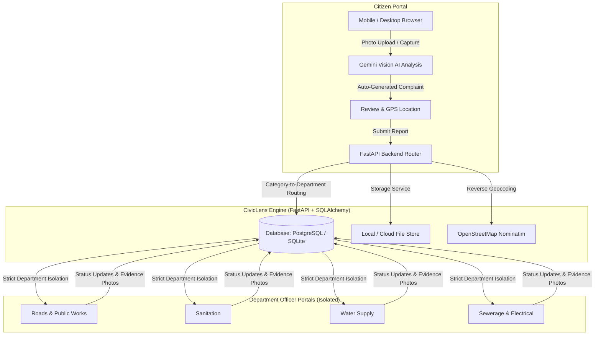

# CivicLens — AI-Powered Civic Issue Reporting and Resolution Platform

[](https://render.com/deploy?repo=https://github.com/duttarajdeep67-lab/civic-lens)

> **"See It. Report It. Resolve It."**

CivicLens is a full-stack, enterprise-grade civic governance platform that empowers citizens to report public infrastructure and maintenance problems with a single photograph. Rather than burdening citizens with manual forms and bureaucracy, CivicLens integrates multimodal **Google Gemini Vision AI** to automatically inspect uploaded photos, identify visible defects, draft professional complaints, determine issue severity, and route reports directly to the responsible municipal departments.

Department officers access isolated operational dashboards to review assigned issues, coordinate field maintenance, and upload photographic resolution evidence.

---

## 🏛️ System Architecture



---

## 🚀 Key Features

1. **Multimodal AI Vision Defect Detection**
   - Direct integration with **Google Gemini 2.5 Flash** using the official `google-genai` SDK.
   - Structured JSON output validated using Pydantic schemas.
   - Detects potholes, broken sidewalks, overflowing dumpsters, uncollected garbage, water main leaks, open drains, and dark streetlights.
   - Graceful manual fallback when AI or network connectivity is unavailable.

2. **Automated Category-to-Department Routing**
   - Standardized mapping from 10 civic issue categories to 7 municipal departments.
   - Ambiguous or unrecognized issues automatically route to General Civic Administration for manual review.

3. **GPS Location & Interactive Mapping**
   - Browser Geolocation API ("Use My Current Location") with reverse-geocoding into readable street addresses.
   - Interactive OpenStreetMap via Leaflet with draggable pins and map-click coordinates adjustment.

4. **Transparent Resolution Audit Trail**
   - Complete status lifecycle: `Submitted` → `Under Review` → `In Progress` → `Resolved` (with justified `Rejected` and `Reopened` support).
   - Mandatory resolution notes and official photographic resolution evidence.

5. **Strict Department Access Isolation**
   - Department officers can exclusively view and manage work orders belonging to their assigned department.
   - Cross-department access attempts return `403 Forbidden` with full audit logging.

---

## 💻 Tech Stack

- **Frontend**: React 18, Vite, TypeScript, Tailwind CSS, React Router v7, Lucide Icons, Leaflet / React Leaflet, Recharts, Sonner toasts, React Hook Form, Zod.
- **Backend**: Python 3.11, FastAPI, Pydantic v2, SQLAlchemy ORM, Alembic migrations, HTTPX, Pillow, `google-genai` SDK.
- **Database**: PostgreSQL (Production / Docker) & SQLite (Zero-config local development).
- **Authentication**: JWT Bearer tokens with bcrypt password hashing.

---

## 🔑 Demo Accounts

The database comes pre-seeded with realistic municipal departments, officers, categories, and active complaints.

| Role | Name | Email | Password | Assigned Department |
|---|---|---|---|---|
| **Citizen** | Rajesh Sharma | `citizen@civiclens.gov` | `Citizen123!` | *All citizen features* |
| **Roads Officer** | Vikram Malhotra | `officer.roads@civiclens.gov` | `Officer123!` | Roads and Public Works |
| **Sanitation Officer** | Ananya Deshmukh | `officer.sanitation@civiclens.gov` | `Officer123!` | Sanitation |
| **Water Supply Officer** | Suresh Nair | `officer.water@civiclens.gov` | `Officer123!` | Water Supply |
| **Sewerage Officer** | Pooja Kulkarni | `officer.sewerage@civiclens.gov` | `Officer123!` | Sewerage and Drainage |
| **Electrical Officer** | Amit Patel | `officer.electrical@civiclens.gov` | `Officer123!` | Electrical & Street Lighting |

*Tip: The Sign In page features one-click quick-fill buttons for instant demo switching!*

---

## 🛠️ Local Development Setup

### 1. Prerequisites
- Python 3.11+
- Node.js 20+ and npm

### 2. Backend Setup
```bash
cd backend

# Install Python requirements
python -m pip install -r requirements.txt

# Configure environment variables
# Set your GEMINI_API_KEY in .env (or leave blank to use labeled demo mode)
cp ../.env.example .env

# Run database seed script (populates departments, categories, officers, and sample complaints)
python seed.py

# Start FastAPI backend server
python -m uvicorn app.main:app --host 127.0.0.1 --port 8000 --reload
```

Backend API will be accessible at:
- **API Server:** `http://127.0.0.1:8000`
- **Interactive Swagger Documentation:** `http://127.0.0.1:8000/docs`
- **ReDoc Documentation:** `http://127.0.0.1:8000/redoc`

### 3. Frontend Setup
```bash
cd frontend

# Install Node modules
npm install

# Start Vite development server
npm run dev
```

Frontend application will be accessible at:
- **Web App:** `http://localhost:5173`

---

## 🧪 Running Automated Tests

Run backend integration and unit tests using `pytest`:

```bash
cd backend
python -m pytest tests/ -v
```

All 9 comprehensive tests verify:
1. Public statistics endpoint.
2. Department and category reference catalogs.
3. Citizen registration and credential hashing.
4. Officer authentication and department binding.
5. AI issue categorization & automatic department routing.
6. Department access isolation (403 Forbidden for cross-department tampering).
7. Controlled status lifecycle transitions (`Submitted` → `Under Review` → `In Progress` → `Resolved`).
8. Resolution notes and rejection validation.
9. Reverse-geocoding coordinates resolver.

---

## 🐳 Docker Deployment

To launch the complete platform (PostgreSQL database, FastAPI backend, and Nginx-served React frontend) with Docker Compose:

```bash
# Add your GEMINI_API_KEY to .env
docker-compose up --build -d
```

Services will be running on:
- Frontend: `http://localhost`
- Backend API: `http://localhost:8000`
- PostgreSQL: `localhost:5432`

---

## 🗺️ End-to-End User Journeys Tested

1. **Journey A: Citizen Reports a Road Hazard with AI**
   - Citizen signs in (`citizen@civiclens.gov` / `Citizen123!`).
   - Clicks "Report Issue", captures/uploads photograph.
   - Clicks "Analyze Issue with AI" (invoking Google Gemini Vision).
   - Gemini classifies issue as "Potholes and Damaged Roads" with High priority.
   - Citizen confirms GPS coordinates via interactive draggable map.
   - Submits report, receives unique tracking ID (e.g. `CIV-2026-XXXX`), viewable on dashboard.

2. **Journey B: Officer Resolves Complaint with Evidence**
   - Roads Officer logs in (`officer.roads@civiclens.gov` / `Officer123!`).
   - Opens department dashboard, views complaint in queue.
   - Transitions status: `Submitted` → `Under Review` → `In Progress`.
   - Records repair completion note and uploads resolution evidence photo.
   - Status updates to `Resolved`. Citizen sees live audit timeline with before & after photos.

3. **Journey C: Department Access Isolation**
   - Sanitation Officer logs in (`officer.sanitation@civiclens.gov`).
   - Tries to access or patch a Roads Department complaint URL.
   - Backend denies access with HTTP 403 Forbidden ("Access restricted: This complaint belongs to Roads and Public Works").

4. **Journey D: Manual Fallback when AI is Offline**
   - Citizen can skip AI analysis or report issues manually without AI dependency.
   - Automatic category-to-department routing rules process manual submissions identically.
